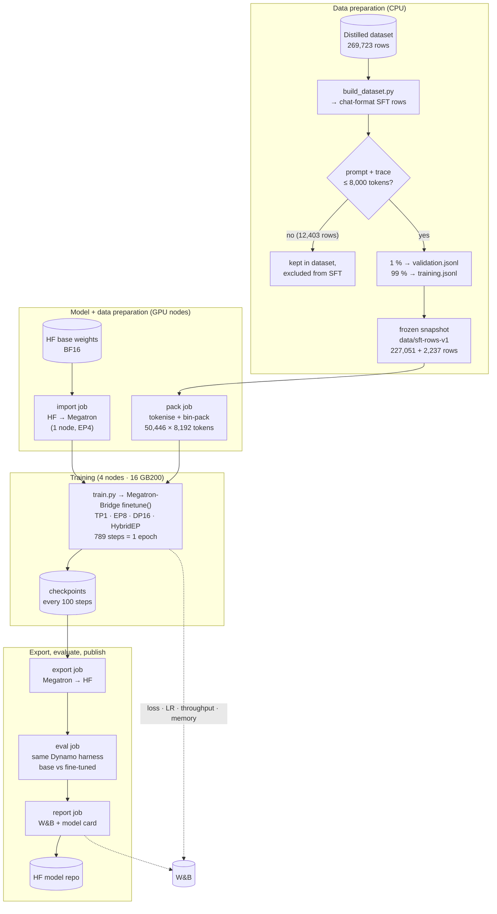
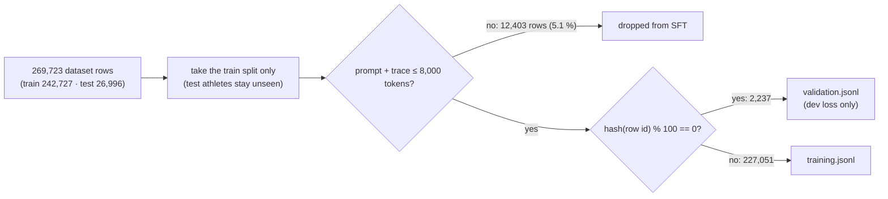
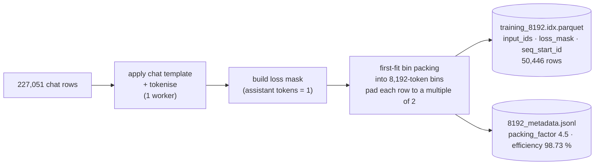
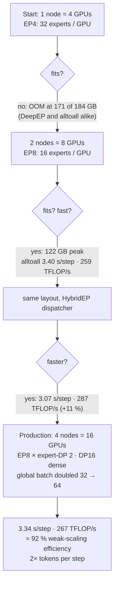
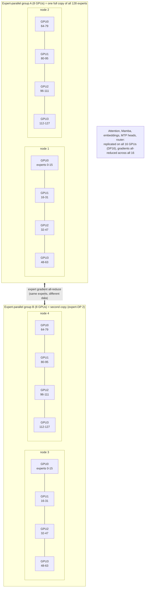
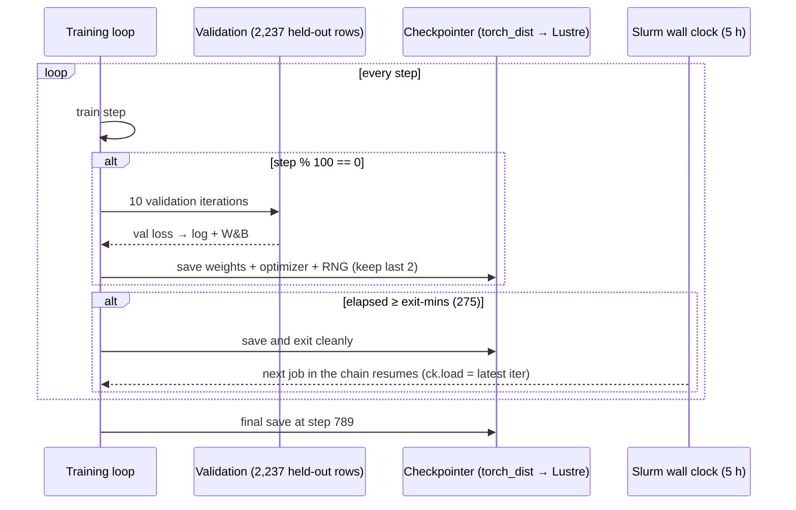
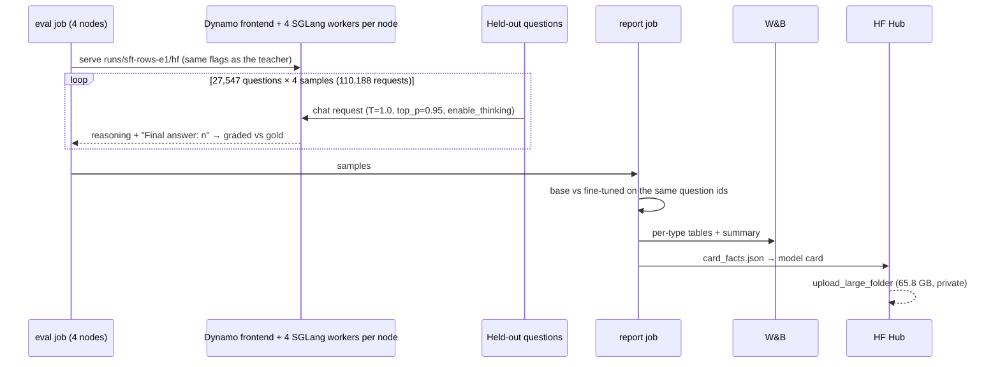
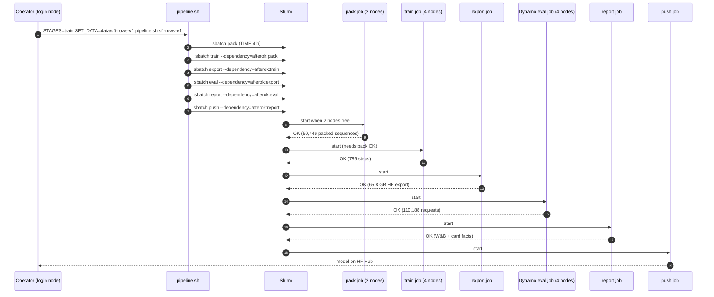
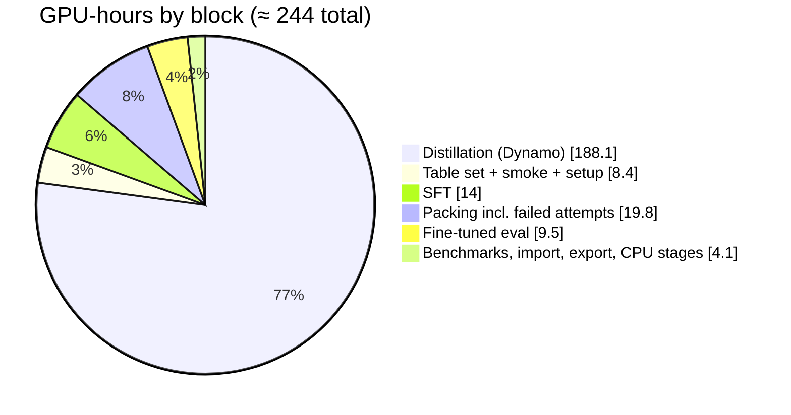

# Fine-tuning Nemotron-3.5-Lightning-30B-A3B on GB200: the complete process

This is the end-to-end record of how the Olympics reasoning model was fine-tuned: **what** was run, **why** each step
exists, **how** it was scaled from 1 to 4 nodes, **what it cost**, and **exactly how to repeat it**. Every number
comes from the job logs, packed-data metadata and W&B metrics of the actual run (`sft-rows-e1`, 2026-10-09). Where a
value is an estimate or a recipe default that was not overridden, it says so.

> Related docs: [../README.md](../README.md) (project overview and results), [../ARCHITECTURE.md](../ARCHITECTURE.md)
> (distillation + fine-tuning architecture). This document goes deep on the **fine-tuning** half.

**Contents**
1. [What we fine-tuned and why](#1-what-we-fine-tuned-and-why)
2. [The pipeline at a glance](#2-the-pipeline-at-a-glance)
3. [Software, hardware and storage](#3-software-hardware-and-storage)
4. [Step 1: training data from the distilled dataset](#4-step-1-training-data-from-the-distilled-dataset)
5. [Step 2: offline sequence packing](#5-step-2-offline-sequence-packing)
6. [Step 3: converting the base checkpoint](#6-step-3-converting-the-base-checkpoint)
7. [Step 4: choosing the parallel layout (how we scaled)](#7-step-4-choosing-the-parallel-layout-how-we-scaled)
8. [Step 5: the training run](#8-step-5-the-training-run)
9. [Step 6: validation, checkpoints and resume](#9-step-6-validation-checkpoints-and-resume)
10. [Step 7: export to Hugging Face format](#10-step-7-export-to-hugging-face-format)
11. [Step 8: evaluation and publishing](#11-step-8-evaluation-and-publishing)
12. [Orchestration: one Slurm dependency chain](#12-orchestration-one-slurm-dependency-chain)
13. [Performance across GPUs](#13-performance-across-gpus)
14. [Cost of the experiments](#14-cost-of-the-experiments)
15. [Reproduce it: step-by-step commands](#15-reproduce-it-step-by-step-commands)
16. [Problems we hit and their fixes](#16-problems-we-hit-and-their-fixes)
17. [What to change next time](#17-what-to-change-next-time)

---

## 1. What we fine-tuned and why

| | |
|---|---|
| Base model | `nvidia/NVIDIA-Nemotron-3.5-Lightning-30B-A3B-BF16`, rev `a9904d2`: a hybrid Mamba + attention **mixture-of-experts** model, 128 experts per MoE layer, ~30B total / **~3B active** parameters per token, with multi-token-prediction (MTP) heads |
| Method | **Full-parameter supervised fine-tuning (SFT)**: every weight is updated, not a LoRA adapter |
| Data | [Balab2021/Olympics-Reasoning-Nemotron-3.5-Lightning](https://huggingface.co/datasets/Balab2021/Olympics-Reasoning-Nemotron-3.5-Lightning): verified reasoning traces over Olympic tables, one per source row |
| Teacher | **The same model**, served with NVIDIA Dynamo + SGLang (rejection-sampling self-distillation) |
| Output | [Balab2021/Nemotron-3.5-Lightning-30B-A3B-Olympics-Reasoning](https://huggingface.co/Balab2021/Nemotron-3.5-Lightning-30B-A3B-Olympics-Reasoning) (private) |

**Why self-distillation?** The model already answered about 92% of the questions correctly, but it often reasoned at
great length and sometimes ran past the token budget. Sampling several answers and training only on the **shortest
correct** one teaches the model to prefer its own concise, successful reasoning paths. The expected outcome is
shorter reasoning and a few more points of accuracy on this task, **not new knowledge**. That is what happened:
reasoning was 12% shorter, accuracy went from 92.00% to 92.35%, and truncation fell from 3.02% to 2.23% on held-out
athletes.

**Why full SFT instead of LoRA?** The EOS H100 run of the same model on cricket data showed that full SFT of
Lightning is tractable with Megatron-Bridge's verified recipe, and GB200 memory (189 GB per GPU) makes it
comfortable. Full SFT also trains the MTP heads and the MoE router together with the experts, which matters for a
model whose speed depends on MTP speculative decoding.

---

## 2. The pipeline at a glance



| # | Stage | Job | Nodes × GPUs | Wall time | Why it exists |
|---|---|---|---|---|---|
| 1 | SFT files | `data.sbatch` (CPU) | 1 | ~2 min | turn verified traces into the chat format the trainer expects; filter rows too long for the sequence length |
| 2 | Packing | `submit.sh bench` (1 step) | 2 × 4 | 1 h 25 min | tokenise once and bin-pack variable-length rows into fixed 8k sequences, so no compute is spent on padding |
| 3 | Import | `submit.sh import` | 1 × 4 | 2 min | Megatron needs its own sharded checkpoint format; converted once and reused |
| 4 | Layout benchmark | `submit.sh bench` | 1–2 × 4 | 5 × ~5 min | pick a parallel layout that fits in memory and is fastest **before** spending the big allocation |
| 5 | **SFT** | `submit.sh train` | **4 × 4** | **52.5 min** | the actual fine-tune: 1 epoch, 789 steps |
| 6 | Export | `submit.sh export` | 1 × 4 | 1.8 min | convert back to HF safetensors so standard servers (Dynamo, SGLang, vLLM, Transformers) can load it |
| 7 | Eval | `gen.sbatch` | 4 × 4 | 35.7 min | score base vs fine-tuned **with the same serving stack and sampling** |
| 8 | Report + push | `data.sbatch`, `submit.sh push` | 1 | 3 min | W&B tables, model card facts, upload of 65.8 GB |

---

## 3. Software, hardware and storage

| Layer | What | Why this choice |
|---|---|---|
| Node | 4 × NVIDIA GB200 (189 GB HBM3e each) + 2 × Grace (144 aarch64 cores), ~940 GB RAM; GB200 **NVL72** NVLink domain | large HBM lets one node hold a lot of the MoE, and NVL72 makes cross-node expert all-to-all fast |
| Container | `nvcr.io/nvidia/nemo:26.08.01` (aarch64 build), imported with enroot to a squashfs on Lustre | ships Megatron-Bridge with the verified `nemotron_3_5_lightning_sft_config` recipe and matching Megatron-Core / Transformer Engine |
| Trainer | Megatron-Bridge `finetune()` + our `train.py` | the recipe encodes the model's architecture and known-good defaults; `train.py` only overrides data, parallelism, batch, LR schedule, logging and checkpointing |
| Scheduler | Slurm + pyxis (`srun --container-image`) | multi-node launch with `torch.distributed.run`, one task per node |
| Storage | code in `$HOME/clustercodes/olympics`; data, packed data, checkpoints, exports, logs and caches on Lustre (`$LUSTRE_DIR/olympics`) | home has a 50 GB quota; one training checkpoint with optimizer state is about 430 GB |
| Tracking | W&B project `nemotron35-olympics-reasoning` (run `sft-rows-e1`), HF Hub | loss curves, throughput, per-GPU system metrics; versioned artifacts |
| Secrets | `$LUSTRE_DIR/secrets.env` (HF token with write scope, W&B key), `chmod 600` | never in code or logs; passed into containers with `--container-env` |

---

## 4. Step 1: training data from the distilled dataset

### 4.1 Row format
`build_dataset.py` writes one JSON object per line with **three chat turns**:

```json
{"messages": [
  {"role": "system", "content": "You are a sports data analyst. Use only the table you are given. Work through the problem step by step, then give the final answer on its own line as 'Final answer: <answer>'."},
  {"role": "user", "content": "All entrants in <event> at the <Games> Olympics ... | Name | NOC | Age | ... |\n\nHow many entrants were taller than <athlete>? ..."},
  {"role": "assistant", "reasoning_content": "<the verified reasoning trace>", "content": "Final answer: 23"}
]}
```

**Why `reasoning_content` instead of putting `<think>` text in `content`:** Nemotron's own chat template renders
`reasoning_content` as `<think>\n…\n</think>` followed by `content`. That is exactly the token layout the model
produces at inference with `enable_thinking=True`, so training and inference see identical formatting.

**Why loss only on the assistant turn** (`ChatSFTPreprocessingConfig(loss_mode="assistant")`): the prompt is a
table we gave the model. Training it to reproduce tables would waste capacity and could teach it to hallucinate
tables. Only the reasoning and answer should be learned. In the packed data, **242.5M of 408.2M tokens (59.4%)**
carry loss.

### 4.2 Filters and splits



* **Why 8,000 tokens:** the packed sequence length is 8,192. A row longer than that would be cut off mid-trace and
  teach the model to stop reasoning abruptly. A little headroom is kept for chat-template tokens.
* **Why hash-based validation:** it is deterministic and reproducible without storing a split file, and it never
  overlaps the benchmark test athletes.
* **Why a frozen snapshot (`data/sft-rows-v1`):** training started while the last 0.4% of dataset rows were still
  being generated. Copying `data/sft` (plus its `rows_dataset_stats.json`) into a new directory means the data under
  a running job cannot change, and the model card can state exactly what was trained on: 227,051 rows taken at
  99.575% row coverage.

---

## 5. Step 2: offline sequence packing

Rows range from a few hundred to 8,000 tokens. Padding every row to 8,192 would waste most of the compute.
**Packing** concatenates several rows into one 8,192-token sequence. Attention is restricted to each row's own span
(`seq_start_id` boundaries / cumulative sequence lengths), so rows never see each other.



| Packing result | Value |
|---|---|
| Training rows in → packed sequences out | 227,051 → **50,446** |
| Rows per sequence (packing factor) | **4.5** on average, at most 15 |
| Fill (real tokens / slots) | **98.79%** (408,249,783 / 413,253,632) |
| Loss tokens | 242,524,018 (59.4%) |
| Validation | 2,237 rows, packing efficiency 98.55% |
| Time | 1 h 25 min, single-threaded tokenisation on Grace |

**Why offline (before training) and not on the fly:** the packed set is computed once and cached next to the data.
Every training job, resume or re-run then starts in seconds instead of re-tokenising 1.1 GB of JSONL.

**Why `num_tokenizer_workers=1`:** with more than one worker, every sample is shared through `file_system` shared
memory. On a previous run with 458K rows this exhausted file mappings (`ENOMEM`). One worker is slow but reliable.

**Why a per-dataset tokenizer path:** Megatron-Bridge names its packed cache
`<tokenizer_path>_pad_seq_to_mult2_sft_<hash>`, and **the hash does not depend on the data**. Our first packing job
silently reused the cache of an earlier 8.7K-row benchmark set and would have trained on the wrong data. The fix in
`train.py`:

```python
def packing_tokenizer(data_dir, hf_model):
    link = os.path.join(data_dir, "tokenizer")      # <data>/tokenizer -> model snapshot
    try:
        os.symlink(hf_model, link)
    except FileExistsError:
        pass                                         # every rank tries; first one wins
    return link                                      # cache now lives at <data>/tokenizer_pad_seq_to_mult2_sft_<hash>/
```

Packing runs as a **1-step "bench" job** (`--bench 1`): Megatron-Bridge packs as part of building the dataset, and
one training step proves the packed data loads. `train.py` then reads the packed count to compute the number of
steps (`ceil(epochs × 50,446 / 64) = 789`).

---

## 6. Step 3: converting the base checkpoint

```bash
PARTITION=<partition> bash $CODE_DIR/submit.sh import     # → $PROJ/ckpts/base-megatron/iter_0000000
```

`job.sbatch` (`STAGE=import`) runs Megatron-Bridge's converter directly with the container's Python, on one node
with experts split over its 4 GPUs:

```bash
/opt/venv/bin/python -m torch.distributed.run --nproc_per_node=4 \
  /opt/Megatron-Bridge/scripts/conversion/run_conversion.py import --device gpu \
  --tp 1 --pp 1 --ep 4 --etp 1 --hf-model "$MODEL_DIR" --megatron-path $PROJ/ckpts/base-megatron
```

* **Why convert:** Megatron loads `torch_dist` sharded checkpoints whose layout matches its parallelism, not HF
  safetensors. The conversion is done once (2 minutes) and every training job loads it as `pretrained_checkpoint`.
* **Why not the `convert.sh` wrapper:** it re-resolves dependencies with `uv`, pulls a newer `huggingface-hub` that
  the image's `transformers` rejects, and fails. Calling `run_conversion.py` directly avoids that.

---

## 7. Step 4: choosing the parallel layout (how we scaled)

### 7.1 What must fit on each GPU
In full SFT every GPU holds, for its share of the model:
- the BF16 weights;
- gradients;
- the optimizer state (Adam moments plus FP32 master weights, about 12 bytes per parameter);
- activations for the micro-batch.

For an MoE model most parameters are **experts**, so how the 128 experts are split across GPUs (expert parallelism,
EP) decides whether it fits.

### 7.2 The scaling path



| Benchmark (8k packed, 20 steps) | GPUs | Step | TFLOP/s per GPU | Peak memory | Outcome |
|---|---|---|---|---|---|
| TP1 · EP4 · selective recompute · DeepEP | 4 | – | – | – | **refused**: DeepEP rejects "NVIDIA GB200" |
| TP1 · EP4 · selective recompute · HybridEP | 4 | – | – | 171 / 184 GB | **OOM** |
| TP1 · EP4 · selective recompute · alltoall | 4 | – | – | 171 / 184 GB | **OOM** |
| TP1 · **EP8** · selective · alltoall · gbs 32 | 8 | 3.40 s | 259 | 122 GB | works |
| TP1 · **EP8** · selective · **HybridEP** · gbs 32 | 8 | **3.07 s** | **287** | 122 GB | **chosen** |
| Production: TP1 · EP8 · HybridEP · **gbs 64** | 16 | 3.34 s | 267.5 | 97 GB (rank 0) | 1 epoch in 52.5 min |

**Why TP1 (no tensor parallelism):** with 189 GB per GPU the dense attention and Mamba weights fit unsplit.
Splitting them (TP2) adds communication on every layer for no memory benefit. On 80 GB H100s (the EOS run) TP2 was
required.

**Why EP8 and not EP16:** EP8 already fits with about 80 GB to spare. EP16 would move each token's expert traffic
across more GPUs for no gain. With 16 GPUs and EP8 there are **two copies** of every expert group (expert-DP 2),
which simply doubles the data each step processes.

**Why HybridEP:** the recipe defaults to the DeepEP flex dispatcher, which checks the GPU name and accepts only
B200/B300, H100-class and A100-class parts. HybridEP is Megatron's dispatcher built for **GB200/GB300 NVL72**
NVLink domains, and it was 11% faster than plain all-to-all.

**Why selective recompute (`moe, layernorm, core_attn, mlp`):** activations of an 8k sequence through 128-expert MoE
layers are large. Recomputing these modules in the backward pass trades some compute for activation memory and
keeps the peak well below 189 GB.

**Why 4 nodes for production rather than 2:** doubling GPUs and the global batch together (weak scaling) cut the
epoch wall time almost in half (an estimated ~90 min on 2 nodes vs 52.5 min on 4) at 92% per-GPU efficiency. More
nodes would shorten it further, but queue time on a busy partition grows with node count.

### 7.3 The production layout



| Parallel dimension | Size | Meaning |
|---|---|---|
| Tensor parallel (TP) | 1 | each layer's weights are whole on one GPU |
| Pipeline parallel (PP) | 1 | every GPU holds all layers |
| Context parallel (CP) | 1 | each 8k sequence stays on one GPU |
| Expert parallel (EP) | **8** | 128 experts split 16 per GPU across 8 GPUs (2 nodes) |
| Expert tensor parallel (ETP) | 1 | each expert's weights are whole |
| Data parallel (dense) | **16** | every GPU processes different sequences |
| Expert data parallel | 2 | two copies of each expert, one per EP group |

---

## 8. Step 5: the training run

### 8.1 Configuration (what `train.py` sets on top of the recipe)

| Setting | Value | Why |
|---|---|---|
| Recipe | `nemotron_3_5_lightning_sft_config()` | model architecture, precision and optimizer defaults verified by NVIDIA for this model |
| Sequence length | 8,192 | covers 94.9% of rows; the rest are excluded rather than truncated |
| Global batch | **64 packed sequences** (≈ 517K real tokens) | 4 sequences per GPU per step on 16 GPUs; about 790 steps per epoch is enough for a smooth cosine schedule |
| Micro batch | 1 | an 8k sequence per forward pass, with gradients accumulated 4× per step |
| Epochs → steps | 1 → **789** = ceil(50,446 / 64) | self-distillation targets the model's own outputs, so one pass is enough and more epochs risk overfitting the style |
| Learning rate | **5e-6** peak, **30-step warm-up**, **cosine** to **5e-7** | gentle full-parameter update that keeps general capability; warm-up avoids an early spike while the optimizer state is empty |
| Optimizer, precision, clipping, weight decay | recipe defaults (not overridden) | known-good for this model |
| Loss | cross-entropy on assistant tokens + recipe MoE load-balancing and MTP losses | MTP heads and router keep training with the experts |
| MoE dispatcher | flex / HybridEP | see §7 |
| Recompute | selective (`moe, layernorm, core_attn, mlp`) | memory headroom |
| Validation | every 100 steps, 10 iterations | catch divergence or overfitting early |
| Checkpointing | every 100 steps, with optimizer + RNG state, keep the 2 most recent | resumable across 5-hour Slurm limits; bounded disk use |
| Exit guard | `--exit-mins 275` | save and exit cleanly before the 5 h wall limit |
| GC | manual every 100 steps | avoids random Python GC pauses desynchronising 16 ranks |
| Compile caches | Triton/Inductor caches in node-local `/tmp/<jobid>` | a shared Lustre cache raced across ranks on EOS ("CUDA driver error: file not found") |

Launch (one task per node; `torchrun` starts 4 ranks each):

```bash
PARTITION=<partition> SFT_DATA=$PROJ/data/sft-rows-v1 bash $CODE_DIR/submit.sh train 4 sft-rows-e1 \
  --tp 1 --ep 8 --recompute selective --dispatcher hybridep --gbs 64 \
  --epochs 1 --save-interval 100 --eval-interval 100 --eval-iters 10
```

### 8.2 What happens in one step

```mermaid
sequenceDiagram
    autonumber
    participant DL as Data loader (each of 16 ranks)
    participant G as GPU rank r (dense + Mamba + attention)
    participant RT as MoE router (on rank r)
    participant HE as HybridEP dispatcher (NVLink, inside EP group)
    participant EX as Expert GPUs in the same EP group
    participant AR as Gradient all-reduce
    participant OPT as Optimizer
    loop 4 micro-batches (gradient accumulation)
        DL->>G: 1 packed 8,192-token sequence (≈ 4.5 rows) + loss mask
        G->>G: Mamba / attention blocks (per-row boundaries)
        G->>RT: hidden states at each MoE layer
        RT->>HE: top-k expert choice per token
        HE->>EX: all-to-all: send tokens to the GPUs that own those experts
        EX->>EX: expert MLPs (16 experts per GPU)
        EX->>HE: expert outputs
        HE->>G: all-to-all back (combine)
        G->>G: LM loss on assistant tokens + MTP loss + load-balancing loss
        G->>G: backward (selective recompute of moe / layernorm / attn / mlp)
        Note over G,EX: backward repeats the dispatch / combine in reverse
    end
    G->>AR: dense + Mamba grads: all-reduce over 16 ranks
    EX->>AR: expert grads: all-reduce over the 2 expert copies
    AR->>OPT: averaged gradients
    OPT->>G: Adam update (recipe defaults), LR from warm-up + cosine schedule
    Note over DL,OPT: ≈ 3.34 s per step · 64 sequences · ≈ 517K tokens
```

### 8.3 Timeline of the run

```mermaid
gantt
    title sft-rows-e1 (2026-10-09, 16 × GB200)
    dateFormat HH:mm:ss
    axisFormat %H:%M
    section Job 2991539
    Container start, model build, load base ckpt :a1, 12:03:37, 120s
    Warm-up steps 1-5 (CUDA graphs, first all-to-alls) :a2, after a1, 133s
    Steps 6-789 incl. 8 validations + 8 checkpoints :a3, after a2, 2841s
    Final validation, save, exit :a4, after a3, 55s
```



| Phase | Time |
|---|---|
| Container start, model build, load base checkpoint | ~2 min |
| First 5 steps (26.6 s per step: graph capture, first all-to-alls) | ~2.2 min |
| 784 steady steps × 3.34 s | **~43.6 min** |
| 8 validations + 8 checkpoint saves (~430 GB each, `torch_dist` to Lustre) | ~4.5 min |
| **Total** | **52.5 min (12:03:37 → 12:56:06)** |

### 8.4 Throughput

| Metric (steps after the first 20) | Value |
|---|---|
| Step time | mean **3,337 ms**, median 3,325, p95 3,464, min 3,156, max 3,790 |
| Model FLOP/s per GPU (Megatron's formula) | mean **267.5 TFLOP/s**, range 235.5–282.5 |
| Real tokens / s | **≈ 155K across 16 GPUs ≈ 9.7K per GPU** |
| Loss tokens / s | ≈ 92K |
| Weak scaling, 2 → 4 nodes | 3.07 → 3.34 s per step ≈ **92%** |
| Utilisation of dense BF16 peak (~2.5 PFLOP/s per GB200) | ≈ 11%, typical for a ~3B-active MoE where small expert GEMMs, Mamba scans and all-to-all dominate |

### 8.5 Training curves

| Step | LR | Train loss | Grad norm | MTP-1 loss | Load-balance loss | Val loss |
|---|---|---|---|---|---|---|
| 5 | 8.3e-7 | 0.104 | 2.75 | 1.007 | 1.051 | |
| 10 | 1.7e-6 | 0.106 | 3.33 | 1.012 | 1.053 | |
| 50 | 5.0e-6 | 0.099 | 0.41 | 0.536 | 1.047 | |
| 100 | 4.9e-6 | 0.101 | 0.40 | 0.469 | 1.029 | 0.1013 |
| 200 | 4.5e-6 | 0.100 | 0.39 | 0.418 | 1.006 | 0.1045 |
| 300 | 3.7e-6 | 0.101 | 0.34 | 0.379 | 0.992 | 0.1033 |
| 400 | 2.8e-6 | 0.096 | 0.35 | 0.347 | 0.984 | 0.1016 |
| 500 | 1.9e-6 | 0.097 | 0.31 | 0.329 | 0.979 | 0.1013 |
| 600 | 1.2e-6 | 0.100 | 0.32 | 0.324 | 0.978 | 0.0995 |
| 700 | 6.5e-7 | 0.094 | 0.31 | 0.308 | 0.976 | 0.0980 |
| 785 / 789 | 5.0e-7 | 0.095 | 0.30 | 0.312 | 0.976 | **0.0973** |

How to read this:
- **Low starting loss (~0.10):** the targets were written by this same model, so it already assigns them high
  probability. A large drop is not expected or desirable.
- **Validation loss fell steadily after step 200**, and there is no sign of overfitting in one epoch.
- **The MTP head adapted most (1.01 → 0.31):** the multi-token-prediction head learned the new, more concise
  output style.
- **The load-balancing loss settled near 1.0:** tokens were spread evenly across the 128 experts.
- **Grad norm settled at about 0.3 after warm-up:** stable training.

---

## 9. Step 6: validation, checkpoints and resume



* `ck.load` is set automatically when the save directory already holds an `iter_*`, so resubmitting the **same
  command** resumes from the latest checkpoint with optimizer and RNG state. Chaining a second job with
  `DEPEND=<jobid>` continues a run that needs more than one 5-hour allocation. This run finished in one.
* Checkpoints on disk: `iter_0000700` and `iter_0000789`, **859 GB** in total. The optimizer state is most of it.

---

## 10. Step 7: export to Hugging Face format

```bash
PARTITION=<partition> bash $CODE_DIR/submit.sh export sft-rows-e1     # latest iter → $PROJ/runs/sft-rows-e1/hf
```

* `run_conversion.py export --tp 1 --pp 1 --ep 4 --etp 1 --torch-dtype bfloat16 --export-weight-dtype bfloat16`,
  1 node, **1.8 min** → 14 safetensors shards, **65.8 GB**.
* **Why we copy the base model's `config.json`, tokenizer files, chat template and license afterwards:** the
  exporter writes `max_position_embeddings=4096` and `num_nextn_predict_layers=2` into `config.json`, seen on EOS.
  The weights have the same shapes as the base model, so shipping the original configs keeps the full context
  length and the correct MTP settings.
* Inside `job.sbatch` this copy sits in a single-quoted `bash -c '…'` block, so it uses `if …; then cp; fi` (safe
  under `set -e`) and **no apostrophes** in comments.

---

## 11. Step 8: evaluation and publishing



**Why the same Dynamo harness:** the base model's scores come from the samples produced during distillation. Serving
the fine-tuned export with identical flags and sampling makes the comparison like for like. Only questions both
models answered with the same wording are compared.

| Benchmark | Base | Fine-tuned | Mean tokens | Truncated |
|---|---|---|---|---|
| Row questions (23,861, held-out athletes, trained types) | 92.00% | **92.35%** | 2,209 → **1,951** | 3.02% → **2.23%** |
| Table questions (550, types **not** in SFT) | 93.98% | 93.05% | 2,467 → 2,529 | 4.59% → 5.32% |

What the results say:
- **On the types it trained on**, the model became **12% more concise** with fewer runaway traces, and slightly
  more accurate. The largest gains were on the hardest types: `ev_taller` +1.6 and `ev_older` +1.2 points.
- **On types it did not train on** (country medal tallies) it lost 2.7–4.3 points, about 2 standard errors. Narrow
  self-distillation shifts behaviour, so future runs should mix those types in.

---

## 12. Orchestration: one Slurm dependency chain

Every stage is a separate job, chained with `--dependency=afterok:<previous>` by `pipeline.sh`, so the whole flow
runs unattended. If any stage fails, the rest are cancelled instead of running on bad inputs.



| Switch | Effect |
|---|---|
| `STAGES=all\|data\|train` | run both chains, only the data chain, or only the training chain |
| `SFT_DATA=<dir>` | train from a frozen copy instead of `data/sft` |
| `FROM=start\|retry2` | where the data chain starts |
| `PARTITION`, `GEN_NODES`, `TRAIN_NODES` | where and how wide |

As it actually ran: pack 2991538 (10:30 → 11:55), train 2991539 (12:03 → 12:56), export 2991540 (12:56 → 12:58),
eval 2991541 (12:58 → 13:34), report 2991542 (13:35 → 13:35), push 2991543 (13:36 → 13:38). Queue gaps between
stages were under 10 minutes. Two earlier pack attempts failed (see §16).

---

## 13. Performance across GPUs

Megatron logs averages across ranks. W&B recorded per-GPU system metrics (every ~7.5 s) on the node that hosted the
logger:

| Metric (median over the job) | GPU0 | GPU1 | GPU2 | GPU3 |
|---|---|---|---|---|
| GPU utilisation | 81% | 81% | 83% | 84% |
| SM active | 31.7% | 31.3% | 31.9% | 31.5% |
| Tensor-pipe active | 12.0% | 11.9% | 12.1% | 12.0% |
| DRAM active | 11.7% | 11.6% | 11.7% | 11.7% |
| HBM used | 108.8 GB | 108.9 GB | 108.9 GB | 108.9 GB |
| Power (limit 1,200 W) | 601 W | 609 W | 596 W | 604 W |
| NVLink TX ≈ RX (W&B rate units) | 36.3k | 37.1k | 37.0k | 36.2k |
| SM clock | 2,062 MHz | 2,062 MHz | 2,062 MHz | 2,062 MHz |

* **Balanced:** all four GPUs match to within a few percent on every metric. Together with the load-balancing loss
  near 1.0, that means no expert GPU was a hot spot.
* **Not compute-bound:** the GPUs were 81–84% busy but only about 12% tensor-pipe active, at half the power limit.
  For a ~3B-active MoE, time goes to many small expert GEMMs, Mamba scans, recompute and all-to-all. The levers are
  a larger micro-batch, fewer recompute modules (there is memory to spare) and fused or grouped expert GEMMs.
* **Memory headroom:** Megatron's rank-0 peak was 96.9 GB allocated (99.7 GB reserved), and NVML saw about 109 GB
  including the CUDA context and NCCL buffers. That leaves **~80 GB free per GPU**, enough for 16k sequences or
  micro-batch 2.

Reproduce the per-GPU table: `python tools/wandb_sysstats.py <entity>/nemotron35-olympics-reasoning/<run_id>`.

---

## 14. Cost of the experiments

The cluster is internal, so there is no real invoice. Costs below are **GPU-hours from the Slurm accounting** (wall
time × GPUs allocated, with whole nodes allocated exclusively), converted to money at **illustrative** rates.
Replace the rate with your organisation's internal or cloud price per GB200 GPU-hour.

### 14.1 Fine-tuning side

| Job | Nodes × GPUs | Wall time | GPU-hours | Note |
|---|---|---|---|---|
| Import HF → Megatron | 1 × 4 | 2.1 min | 0.14 | once per base model |
| Layout benchmarks (5 jobs) | 1–2 × 4 | 1.3 + 5.6 + 5.5 min (1 node); 4.7 + 4.7 min (2 nodes) | 2.1 | 3 OOM or refused, 2 successful |
| Pack attempt 1 (stale cache, caught) | 2 × 4 | 3.7 min | 0.5 | wasted |
| Pack attempt 2 (1 h time limit) | 2 × 4 | 60 min | 8.0 | wasted |
| Pack attempt 3 (success) | 2 × 4 | 85 min | 11.3 | CPU-bound; GPUs idle |
| **SFT** | **4 × 4** | **52.5 min** | **14.0** | the fine-tune itself |
| Export Megatron → HF | 1 × 4 | 1.8 min | 0.12 | |
| Dynamo eval of the fine-tuned model | 4 × 4 | 35.7 min | 9.5 | 110,188 requests |
| Report + push | 1 × 4 | 2.8 min | 0.19 | CPU work on an exclusive GPU node |
| **Total fine-tuning side** | | | **≈ 45.9** | |
| of which productive (SFT + eval + export/import/report) | | | ≈ 24.0 | |
| of which avoidable (failed packs + packing on GPU nodes) | | | ≈ 19.8 | see §17 |

### 14.2 Whole project, for context (dataset distillation + fine-tuning)

| Block | GPU-hours |
|---|---|
| Dataset distillation with Dynamo (first pass 12 nodes 2 h 03 m = 98.8; retry 47.3; fallback 14.7; retry2 24.9; fallback2 2.4) | ≈ 188.1 |
| Benchmark table set (4 nodes, 26 min) + smoke tests + image import | ≈ 8.4 |
| CPU data stages on exclusive GPU nodes (~12 short jobs) | ≈ 1.5 |
| Fine-tuning side (above) | ≈ 45.9 |
| **Total** | **≈ 244 GPU-hours** |

### 14.3 Converted to money (illustrative rates)

| Rate per GB200 GPU-hour → | $3 | $6 | $10 |
|---|---|---|---|
| SFT run alone (14.0 GPU-h) | $42 | $84 | $140 |
| Fine-tuning side as run (45.9) | $138 | $275 | $459 |
| Fine-tuning side, waste removed (~26) | $78 | $156 | $260 |
| Whole project (244) | $732 | $1,464 | $2,440 |



**Other costs:**
- **Storage:** about 1.3 TB on Lustre at peak (checkpoints 859 GB, export 66 GB, base Megatron checkpoint, samples
  and data). Deleting the `iter_0000700` checkpoint and the optimizer state after export recovers most of it.
- **Hub and tracking:** the HF Hub (public dataset, private model) and W&B were used within their standard plans.
- **People time:** the pipeline ran unattended once chained. Most wall-clock delay was queue time on a busy
  partition, not compute.

**Cost per unit:**
- SFT: about **$0.10–0.34 per million training tokens** at $3–10/GPU-h (14.0 GPU-h for 408M tokens), or
  ~29M tokens per GPU-hour.
- Distillation: about $0.11–0.37 per million generated tokens (188 GPU-h for 5.04B output tokens).

---

## 15. Reproduce it: step-by-step commands

Prerequisites:
- a Slurm cluster with GB200 nodes and pyxis/enroot;
- the NeMo 26.08.01 squashfs, imported on a compute node by `setup.sbatch`;
- the base model in the HF cache on Lustre (`setup_login.sh`);
- `secrets.env` holding `HF_TOKEN` (write) and `WANDB_API_KEY`;
- the distilled dataset built by `build_dataset.py`, or downloaded from the Hub and converted to `messages` rows.

```bash
set -a; source ~/clustercodes/olympics/config.env; set +a
S=$CODE_DIR/submit.sh; P=<partition-with-GB200-nodes>

# 1. SFT files + frozen snapshot (CPU, compute node)
STAGE=final FINAL_ARGS="--allow-missing 8" sbatch -p $P --export=ALL $CODE_DIR/data.sbatch   # writes data/sft/*.jsonl
cp -r $PROJ/data/sft $PROJ/data/sft-rows-v1 && cp $PROJ/data/rows_dataset_stats.json $PROJ/data/sft-rows-v1/

# 2. base checkpoint (once)
PARTITION=$P bash $S import

# 3. (optional) layout benchmark on a small set: 20 steps, prints step time, TFLOP/s, memory
SFT_DATA=$PROJ/data/sft-bench PARTITION=$P BENCH_STEPS=20 bash $S bench 2 n2-ep8-hybridep \
    --tp 1 --ep 8 --recompute selective --gbs 32 --dispatcher hybridep

# 4. everything else as one chain: pack (4 h limit) -> train -> export -> Dynamo eval -> report -> push
STAGES=train SFT_DATA=$PROJ/data/sft-rows-v1 TRAIN_NODES=4 PARTITION=$P bash $CODE_DIR/pipeline.sh sft-rows-e1

# monitor
squeue --me -t PENDING,RUNNING -o "%.10i %.40j %.8T %.6D %.10M %.20R"
tail -f $LOG_DIR/olympics/general_sa-olympics.sft-sft-rows-e1-<jobid>.out | grep --line-buffered -E "iteration|validation"
```

Checks after each stage:
- **Pack:** `<data>/tokenizer_pad_seq_to_mult2_sft_*/training_8192.idx.parquet` exists, and the train log prints
  `50446 packed sequences … -> 789 iters`. A small number means a stale cache: check that the path is under
  `<data>/`.
- **Train:** iteration lines show ~3.3 s and ~270 TFLOP/s, and validation loss falls. The W&B run has loss, LR and
  throughput.
- **Export:** `runs/<run>/hf` has 14 shards, about 66 GB, and `config.json` matches the base model's.
- **Eval/report:** `runs/<run>/eval/report.json` and `card_facts.json` exist; W&B has an `eval-<run>` run.

---

## 16. Problems we hit and their fixes

| Symptom | Cause | Fix (in code now) |
|---|---|---|
| `ValueError: DeepEP is supported for … B200/B300 … Current GPU: NVIDIA GB200` | the recipe defaults to the DeepEP flex dispatcher, which checks the device name | `--dispatcher hybridep` → `apply_flex_dispatcher_backend(m, "hybridep")` |
| OOM at 171 / 184 GB on 1 node | 32 experts per GPU with full-SFT optimizer state | EP8 over 2+ nodes (16 experts per GPU) |
| Train log said **1,056** packed sequences (the bench set) | Megatron-Bridge's packed-cache hash ignores the data, so a second dataset reused the first one's pack | per-dataset tokenizer symlink `<data>/tokenizer`; caught before training by holding the job (`scontrol hold`) |
| Pack job `TIMEOUT` after 1 h | single-worker tokenisation of 227K rows on Grace takes ~85 min | 4 h limit on the pack stage in `pipeline.sh` |
| `syntax error near unexpected token '('` in the job | an apostrophe ("model's") in a comment inside a single-quoted `bash -c '…'` block | reworded; no apostrophes inside those blocks |
| Export `config.json` with `max_position_embeddings=4096` | exporter default | copy the base model's configs and tokenizer into the export |
| `convert.sh` breaks `transformers` | `uv` re-resolves to a newer `huggingface-hub` | call `run_conversion.py` with `/opt/venv/bin/python` directly |
| Triton "CUDA driver error: file not found" (EOS) | compile cache on Lustre shared by all ranks | node-local `TRITON_CACHE_DIR`/`TORCHINDUCTOR_CACHE_DIR` |
| `scontrol update Partition=` rejected for pending jobs | time-limit validation on partition change | cancel and resubmit the chain on the new partition |

---

## 17. What to change next time

| Change | Expected effect |
|---|---|
| Run packing as a **CPU-only job** (or several tokenizer workers on a node with a large shared-memory limit) | saves ~11 GPU-h per run; no GPU nodes held idle |
| Use **16k packed sequences**; there is ~80 GB of headroom | brings back the 12,403 longest, hardest traces where gains matter most (`ev_older`, `ev_taller`) |
| **Mix in the table-question types** (and some general data) | removes the out-of-distribution regression on country-medal tallies |
| Micro-batch 2 or a lighter recompute set | higher tensor-core utilisation; fewer, larger expert GEMMs |
| 8 nodes with global batch 128 (EP8 × expert-DP 4) | about half the wall time per epoch if weak scaling holds (~90%) |
| RL with the exact-answer verifier (e.g. GRPO in NeMo RL) instead of or after SFT | optimises correctness directly rather than imitating the model's own samples |
| A stronger teacher | room for real accuracy gains; self-distillation at a ~92% base has a low ceiling |
